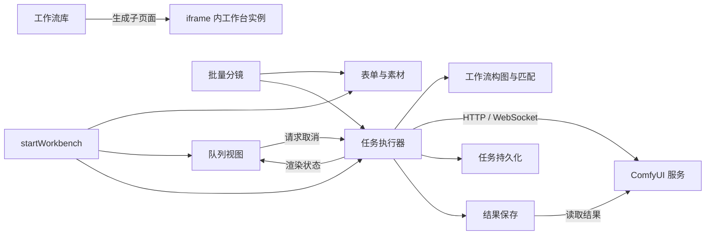

# Frameform 工作台架构分析

分析日期为 2026-11-22。基线为 `main` 分支、`HEAD 645b88c` 上的本地工作区，包含当时已修改和未跟踪的源码。文中的相对链接和行号指向该工作区。分析范围覆盖生产源码、工作流配置、构建脚本和测试代码；`dist/`、`backups/`、`node_modules/` 分别作为产物、备份和第三方依赖处理。[.gitignore L1–7](.gitignore#L1) · [scripts/build.mjs L7–12](scripts/build.mjs#L7)

**系统边界。** 浏览器负责采集输入、组装工作流、提交任务、同步状态和展示结果。用户配置的 ComfyUI 服务接收节点图、执行任务，并提供队列、历史和媒体文件。Node.js 和 Python 用于构建、分发和测试。本文依据静态源码，未执行构建、浏览器测试或真实 ComfyUI 任务。[src/workbench.js L12–40](src/workbench.js#L12) · [src/jobs/runner.js L359–456](src/jobs/runner.js#L359) · [scripts/build.mjs L37–54](scripts/build.mjs#L37)

## 1. 模块与技术栈

| 模块 | 职责和实现依据 |
|---|---|
| 应用装配与界面 | 前端使用原生 JavaScript ES Modules、HTML、CSS 和 DOM 事件。`startWorkbench` 组装服务器管理、参数控件、编辑器、播放器、队列和批量导入。编辑器保留可恢复的表单快照，提交时再生成服务器使用的提示词。[src/workbench.js L12–40](src/workbench.js#L12) · [src/ui/dom.js L1–14](src/ui/dom.js#L1) · [src/ui/composer.js L588–615](src/ui/composer.js#L588) |
| ComfyUI 适配 | `config.js` 从页面读取 graph 与 profile；`workflow.js` 改写提交图并从服务器图恢复表单；`references.js` 绑定素材；`advanced.js` 筛选可编辑字段；`api.js` 处理 URL、请求超时及节点错误。[src/comfy/config.js L3–15](src/comfy/config.js#L3) · [src/comfy/workflow.js L33–69](src/comfy/workflow.js#L33) · [src/comfy/references.js L21–58](src/comfy/references.js#L21) · [src/comfy/advanced.js L74–93](src/comfy/advanced.js#L74) · [src/comfy/api.js L17–79](src/comfy/api.js#L17) |
| 工作流库 | 解析 API JSON，从选定输出沿连线回溯输入，生成控件映射。用户确认后保存工作流，在独立 iframe 中打开。读取旧记录时会修复特定 H3 工作流的提示词和时长映射。[src/library/graph.js L7–34](src/library/graph.js#L7) · [src/library/mapping.js L264–334](src/library/mapping.js#L264) · [src/library/mapping.js L379–418](src/library/mapping.js#L379) · [src/library/panel.js L389–425](src/library/panel.js#L389) |
| 批量项目 | 读取分镜文本和素材，校验时长、引用类型、编号及文件匹配情况，按文件名排序。通过预检的分镜复用手动生成的提交链路。[src/batch/project.js L10–51](src/batch/project.js#L10) · [src/batch/project.js L142–160](src/batch/project.js#L142) · [src/batch/project.js L183–229](src/batch/project.js#L183) · [src/batch/dialog.js L280–305](src/batch/dialog.js#L280) |
| 任务与结果 | `state.js` 定义任务身份和状态；runner 负责提交与跟踪；队列视图接收任务操作；播放器和 history 模块加载结果、补全详情并支持复用。[src/jobs/state.js L1–25](src/jobs/state.js#L1) · [src/jobs/runner.js L581–588](src/jobs/runner.js#L581) · [src/jobs/queue-view.js L95–119](src/jobs/queue-view.js#L95) · [src/jobs/player.js L30–50](src/jobs/player.js#L30) · [src/jobs/history.js L21–54](src/jobs/history.js#L21) |
| 存储与媒体 | 存在两种模式。托管模式下 `workspace/store.py` 用 SQLite 保存 records、jobs、媒体索引和队列版本，媒体按 SHA-256 内容寻址写入 `assets/`、`outputs/`，由 `workspace/worker.py` 后台提交和归档。浏览器本地模式用 Web Storage 保存表单和任务摘要，IndexedDB 保存素材、缓存和工作流库。媒体模块从结果中识别图片或视频，支持预览、下载、ZIP，以及按设置自动缓存视频和首帧或写入本机目录。[workspace/store.py L22–92](workspace/store.py#L22) · [workspace/worker.py L56–98](workspace/worker.py#L56) · [src/storage/browser.js L17–53](src/storage/browser.js#L17) · [src/storage/jobs.js L26–72](src/storage/jobs.js#L26) · [src/media/outputs.js L66–112](src/media/outputs.js#L66) |
| 配置与交付 | `workflows/*.api.json` 定义节点与实际连线，配套 profile 指定输出和可编辑字段。Node.js ≥20 与 esbuild 0.28.2 生成浏览器脚本，Python 标准库校验配置并生成 HTML、打包 Skill。[workflows/pika-h3.profile.json L2–25](workflows/pika-h3.profile.json#L2) · [package.json L5–15](package.json#L5) · [scripts/workbench.py L413–440](scripts/workbench.py#L413) · [scripts/package_skill.py L7–20](scripts/package_skill.py#L7) |

## 2. 启动入口

| 入口 | 触发位置与启动行为 |
|---|---|
| 集成工作台 `dist/Frameform.html` | 用户打开 HTML。页面底部先提供 graph 和 profile，再执行内联 runtime。`src/main.js` 在顶层调用 `startWorkbench()`。启动时恢复任务、恢复草稿、刷新当前服务器队列，并监听工作台再次激活事件。[src/ui/page.html L102–106](src/ui/page.html#L102) · [src/main.js L1–3](src/main.js#L1) · [src/workbench.js L58–65](src/workbench.js#L58) |
| 集成页工作流库 | `src/library/panel.js` 是单独打包的第二个生产脚本。它在顶层绑定导入、删除、切换事件，并调用 `readWorkflows()` 恢复上次选择；对于仍有已发送活动任务的工作流，它会创建后台子页面。[scripts/build.mjs L79–89](scripts/build.mjs#L79) · [scripts/build.mjs L122–133](scripts/build.mjs#L122) · [src/library/panel.js L478–500](src/library/panel.js#L478) |
| 导入工作流的子页面 | `activateFrame()` 首次创建 iframe，将该工作流的 graph、profile 和同一份 runtime 填入 `srcdoc`。后续切换复用这个实例。[src/library/panel.js L74–112](src/library/panel.js#L74) · [src/library/render.js L22–51](src/library/render.js#L22) |
| Skill 生成的独立 HTML | 包内 Python CLI 的 `build` 子命令可生成指定文件名的独立工作台，用户打开该文件即可启动。集成版的工作流库由 Node 构建脚本在独立页生成之后追加。[scripts/workbench.py L429–459](scripts/workbench.py#L429) · [scripts/build.mjs L91–131](scripts/build.mjs#L91) |
| 开发和分发命令 | `npm run build` 启动 `scripts/build.mjs`。`scripts/workbench.py` 的 `__main__` 分派 `inspect` 和 `build`；前者打印节点与连线，后者生成页面。`scripts/package_skill.py` 接收目录参数并直接写 ZIP。[package.json L9–12](package.json#L9) · [scripts/workbench.py L59–74](scripts/workbench.py#L59) · [scripts/workbench.py L464–489](scripts/workbench.py#L464) · [scripts/package_skill.py L7–19](scripts/package_skill.py#L7) |
| 测试入口 | `npm test` 启动 `tests/run.py`，由它在独立 Python 子进程中执行各个 `test_*.py`。测试专用浏览器脚本 `tests/browser-entry.js` 也会启动工作台，并将部分状态和函数挂到 `window` 供断言使用。[tests/run.py L17–30](tests/run.py#L17) · [tests/run.py L46–57](tests/run.py#L46) · [tests/browser-entry.js L17–43](tests/browser-entry.js#L17) |

| 本地工作区服务 `npm start` | `package.json` 的 `start` 执行 `python3 -m workspace`，无子命令时进入 serve 分支，读取 `dist/Frameform.html` 并注入 records 快照。子命令另有 `serve`/`backup`/`restore`/`migrate`。数据默认在 `~/FrameformData`。[package.json L10](package.json#L10) · [workspace/__main__.py L6–44](workspace/__main__.py#L6) · [workspace/server.py L89–95](workspace/server.py#L89) |

页面帮助提到的 `python3 -m http.server` 仅用于托管静态 HTML。浏览器本地模式（无 `#frameformWorkspace` 标记）由 `src/ui/standalone.js` 显示工作区引导条，提供地址跳转和 `.ffdata` 迁移导出；工作流 iframe（`about:srcdoc`）和托管页面不显示。[src/storage/workspace.js L1–9](src/storage/workspace.js#L1) · [src/ui/standalone.js](src/ui/standalone.js) · [src/storage/transfer.js L15–112](src/storage/transfer.js#L15)

## 3. 核心依赖关系

下图的箭头表示运行时调用或数据访问。静态 import 和回调是不同的依赖，文件级环路的核对结果见第 8 节。

- **装配关系。** `workbench.js` 把服务器变更回调传给 composer，把 composer 和渲染回调传给 player，把取消回调传给 queue，再把 queue 的渲染和工具栏接口传给 runner。批量模块同时接收 composer、runner、queue 的部分接口。[src/workbench.js L15–30](src/workbench.js#L15) · [src/batch/dialog.js L16–29](src/batch/dialog.js#L16)
- **任务和存储。** runner 调用 `persist()`；存储模块反向导入 `jobs/state.js`，直接读写共享数组。恢复时由存储模块把任务放回数组，再回调 `runner.resume` 启动跟踪。[src/jobs/runner.js L16–23](src/jobs/runner.js#L16) · [src/storage/jobs.js L1–30](src/storage/jobs.js#L1) · [src/storage/jobs.js L75–91](src/storage/jobs.js#L75) · [src/jobs/runner.js L558–564](src/jobs/runner.js#L558)
- **图处理和界面。** UI 从 Comfy 配置取参数；Comfy 配置在模块加载时读取 DOM，图恢复逻辑还调用 UI 的提示词格式化函数。高级字段逻辑复用工作流库的图遍历函数。因此，独立使用整套构图与恢复模块，需要提供相应页面配置和 DOM 环境。[src/ui/parameters.js L88–96](src/ui/parameters.js#L88) · [src/comfy/config.js L1–13](src/comfy/config.js#L1) · [src/comfy/workflow.js L207–225](src/comfy/workflow.js#L207) · [src/comfy/advanced.js L1–7](src/comfy/advanced.js#L1)
- **工作流库和运行时。** 父页面取出工作台模板、脚本和 CSS，子页面运行同一份 runtime。父子之间还约定了 `data-workbench-ready` 和 `frameform:activate`；激活已就绪的子页面会刷新其队列。[src/library/panel.js L39–46](src/library/panel.js#L39) · [src/library/panel.js L114–138](src/library/panel.js#L114) · [src/workbench.js L58–65](src/workbench.js#L58)

## 4. 业务入口与函数调用

| 用户动作或系统事件 | 调用链及关键分支 |
|---|---|
| 点击生成，或 Ctrl/Cmd + Enter | 两种操作进入同一按钮处理器。`serverAddress → composer.snapshot → runner.enqueue → runner.submitWaiting → submit`。本地提交循环逐条等待提交结果，服务器生成可以继续进行。[src/workbench.js L31–49](src/workbench.js#L31) · [src/jobs/runner.js L547–578](src/jobs/runner.js#L547) |
| 选择分镜目录并确认入队 | 选择目录触发 `readBatchProject → parseScene → renderBatchPreview`；点击入队后执行 `importMaterial → makeBatchJob → enqueue → submitWaiting`。预检和发送是两个独立动作。[src/batch/project.js L213–229](src/batch/project.js#L213) · [src/batch/dialog.js L215–228](src/batch/dialog.js#L215) · [src/batch/dialog.js L261–305](src/batch/dialog.js#L261) |
| 选择工作流 JSON 并创建工作台 | `parseWorkflow → reviewOutputs → refreshMapping → mappingCandidates`；节点检查按钮可另外请求 `/object_info`。确认后执行 `addWorkflow → activate → activateFrame → workspaceDocument`。[src/library/panel.js L188–205](src/library/panel.js#L188) · [src/library/panel.js L320–374](src/library/panel.js#L320) · [src/library/panel.js L398–425](src/library/panel.js#L398) · [src/library/panel.js L97–110](src/library/panel.js#L97) |
| 请求取消或收到执行事件 | 取消按钮调用 `requestCancel`。尚未发送时中止准备并本地结束；已经发送时进入 `stopping`，唤醒 `poll → cancelRemote`。WebSocket 的成功事件触发立即轮询，错误或中断事件可直接触发 `finish`。[src/jobs/queue-view.js L95–102](src/jobs/queue-view.js#L95) · [src/jobs/runner.js L163–176](src/jobs/runner.js#L163) · [src/jobs/runner.js L258–273](src/jobs/runner.js#L258) · [src/jobs/runner.js L343–357](src/jobs/runner.js#L343) |
| 打开详情、复用或删除任务 | 点击终态任务进入 `selectJob → showResult`。详情调用 `ensureJobForm` 补全记录；点击复用才调用 `applyComposer`。确认删除终态记录会写本地删除标识、移除行并清理媒体缓存。[src/jobs/player.js L30–50](src/jobs/player.js#L30) · [src/jobs/player.js L161–169](src/jobs/player.js#L161) · [src/jobs/queue-view.js L330–353](src/jobs/queue-view.js#L330) |

## 5. 关键业务流程与数据

**生成与构图。** 编辑器快照返回生成参数、提示词、表单、素材文件及其类型。runner 探测服务器后逐个上传所需素材，取得远端路径，再由 `buildGraph` 深拷贝模板、应用高级字段、绑定素材槽、移除未使用的加载节点。profile 决定是否写入时长、尺寸、种子、采样步数，以及是否添加首帧提取与保存节点。最终提交体包含 `prompt`、`client_id`、`prompt_id`；具备工作台 ID 时还附带工作流标识。[src/ui/composer.js L588–615](src/ui/composer.js#L588) · [src/jobs/runner.js L373–410](src/jobs/runner.js#L373) · [src/comfy/workflow.js L33–120](src/comfy/workflow.js#L33)

**内置 Pika H3 工作流的实际连线。** profile 把提示词映射到 `138.value`，指定主输出为 `152`。节点 `136.prompt` 接收 `138[0]`；`125.latent_image` 接收 `136[1]`；`121.samples` 和 `122.samples` 都取 `125[0]`。最后 `152.images` 取 `122[0]`，`152.audio` 取 `121[0]`。方括号中的数字为源节点输出序号。服务器节点内部算法超出本仓库可验证范围。[workflows/pika-h3.profile.json L4–10](workflows/pika-h3.profile.json#L4) · [提示词连线 L194–207](workflows/pika-h3.api.json#L194) · [采样输入 L84–107](workflows/pika-h3.api.json#L84) · [分支输入 L37–66](workflows/pika-h3.api.json#L37) · [最终输出 L314–335](workflows/pika-h3.api.json#L314)

**批量处理的部分成功语义。** 分镜从项目根目录的 `prompts/*.txt` 读取，素材在同根 `assets/` 下收集。校验涵盖正文和文件名时长冲突、素材槽位范围、类型、编号连续性及歧义文件名。确认后仅提交通过预检且素材读取成功的分镜；同批次共享上传路径缓存。界面报告已入队数和跳过原因。[src/batch/project.js L10–51](src/batch/project.js#L10) · [src/batch/project.js L93–160](src/batch/project.js#L93) · [src/batch/project.js L183–215](src/batch/project.js#L183) · [src/batch/dialog.js L247–305](src/batch/dialog.js#L247) · [src/jobs/runner.js L373–398](src/jobs/runner.js#L373)

**状态确认与恢复。** 已知任务通过队列的 running/pending 两组数据核对；离开队列后查询历史，提取可预览媒体或记录失败原因。提交响应不明确时进入 `unknown` 并继续核对。重开页面后，用会话记录和终态归档恢复已知任务；另一路 `scanRunning` 只扫描服务器正在运行的行，通过 ID 去重、工作流标识检查、图结构匹配后导入。此区别决定了哪些远端任务会出现在首次打开的工作台。[src/jobs/runner.js L47–108](src/jobs/runner.js#L47) · [src/jobs/runner.js L237–303](src/jobs/runner.js#L237) · [src/jobs/runner.js L433–456](src/jobs/runner.js#L433) · [src/jobs/runner.js L471–525](src/jobs/runner.js#L471) · [src/storage/jobs.js L75–90](src/storage/jobs.js#L75)

**结果与历史复用。** 完成后，工作台按配置从结果中选择媒体。开启自动保存且存在视频时，才进入视频缓存或目录写入流程。详情缺少表单时，先查本地终态归档，再按 ID 读取服务器历史；`matchWorkflow` 沿输出与输入连接匹配模板，`graphJobData` 从匹配节点反向读取提示词、参数和素材。[src/jobs/runner.js L78–105](src/jobs/runner.js#L78) · [src/media/outputs.js L66–103](src/media/outputs.js#L66) · [src/jobs/history.js L7–42](src/jobs/history.js#L7) · [src/comfy/workflow.js L138–209](src/comfy/workflow.js#L138)

**工作流库生命周期。** 用户从候选输出和控件中确认映射。库在一次 IndexedDB 读写事务中按图和配置查重；相同条目可直接复用，已软删除的条目可恢复。切换工作流主要改变视图可见性，活动任务可以继续在原工作台中跟踪。[src/library/panel.js L169–205](src/library/panel.js#L169) · [src/library/persistence.js L16–66](src/library/persistence.js#L16) · [src/library/panel.js L114–138](src/library/panel.js#L114) · [src/library/panel.js L488–499](src/library/panel.js#L488)

## 6. 外部服务、数据库与本地依赖

| 依赖 | 使用位置与边界 |
|---|---|
| ComfyUI HTTP | 默认地址为 `http://127.0.0.1:8188`，支持自定义 HTTP(S) 地址及代理路径。连接探测用 `GET /system_stats`，节点检查用 `GET /object_info`，素材上传用 `POST /upload/image`，提交图用 `POST /prompt`。跨来源访问取决于目标服务器和浏览器配置。[src/ui/page.html L13](src/ui/page.html#L13) · [src/comfy/api.js L1–15](src/comfy/api.js#L1) · [src/comfy/api.js L97–100](src/comfy/api.js#L97) · [src/library/panel.js L358–377](src/library/panel.js#L358) · [src/jobs/runner.js L385–434](src/jobs/runner.js#L385) |
| 队列、历史、媒体和取消接口 | 状态读取用 `GET /queue`、`GET /history/{id}` 或 `GET /history?max_items=100`，媒体读取用 `/view`。取消优先 `POST /api/jobs/{id}/cancel`；回退时，运行任务走 `POST /interrupt`，等待任务走 `POST /queue` 并携带待移除 ID。[src/jobs/runner.js L218–235](src/jobs/runner.js#L218) · [src/jobs/runner.js L287–301](src/jobs/runner.js#L287) · [src/jobs/runner.js L458–469](src/jobs/runner.js#L458) · [src/comfy/api.js L86–95](src/comfy/api.js#L86) |
| ComfyUI WebSocket | 使用 `/ws?clientId=…` 接收执行、进度和终态事件，通过 prompt ID 过滤消息。连接异常时仍可 HTTP 轮询；断开后对活动任务安排重连。扫描导入的任务采用轮询。[src/jobs/runner.js L118–145](src/jobs/runner.js#L118) · [src/jobs/runner.js L203–216](src/jobs/runner.js#L203) · [src/jobs/runner.js L506–525](src/jobs/runner.js#L506) |
| 浏览器数据库与 Web Storage | IndexedDB 为 `frameform-local` 版本 1，对象仓库为 `files`。其中保存素材、缓存及工作流库。localStorage 保存草稿、设置、删除标识和最近 25 条终态历史；sessionStorage 保存已发送活动任务及归档快照。键的隔离考虑页面路径、工作流 storageKey 和旧版兼容行为。[src/storage/browser.js L3–53](src/storage/browser.js#L3) · [src/storage/jobs.js L11–30](src/storage/jobs.js#L11) · [src/storage/jobs.js L54–72](src/storage/jobs.js#L54) · [src/library/persistence.js L5–32](src/library/persistence.js#L5) · [src/ui/composer.js L163–172](src/ui/composer.js#L163) |
| 本机目录 | 用户通过 `showDirectoryPicker` 授权并保存目录句柄；实际写视频前查询读写权限。缺少目录选择 API 时，设置页禁用相应操作。[src/ui/settings.js L39–56](src/ui/settings.js#L39) · [src/media/outputs.js L88–103](src/media/outputs.js#L88) |
| 模型与节点 | 内置图引用视频及音频 VAE、UNet、CLIP、LoRA 的具体模型文件，也引用 `MiniMaxH3ReferenceToVideo`、`VHS_VideoCombine` 等节点。源码能确认图所要求的名称。真实环境是否安装了兼容的模型和节点尚未验证。[VAE 文件](workflows/pika-h3.api.json#L17) · [UNet 和 CLIP 文件](workflows/pika-h3.api.json#L134) · [H3 节点](workflows/pika-h3.api.json#L262) · [LoRA 文件](workflows/pika-h3.api.json#L282) · [视频输出节点](workflows/pika-h3.api.json#L335) |
| 服务端数据库、Redis、MQ | 托管工作区使用标准库 `sqlite3`（WAL），表为 `records`/`media`/`jobs`/`identity`/`queue_versions`，队列变更由触发器维护版本号；进程锁防止同库双实例。除此之外未发现 Redis、RabbitMQ、Kafka 或其他消息代理。浏览器本地模式的队列是任务数组，远端队列通过 ComfyUI API 读取。[workspace/store.py L22–46](workspace/store.py#L22) · [workspace/server.py L57–70](workspace/server.py#L57) · [src/jobs/state.js L1–18](src/jobs/state.js#L1) |

## 7. 构建、测试及验证边界

**构建。** `npm run build` 使用 esbuild 将浏览器代码打为 ES2022 IIFE，并准备内联样式、图标和脚本。Python 根据 graph 和 profile 检查字段类型、绑定位置、输出节点及分支可达性，生成单 HTML。Node 脚本再装配工作流库，写出集成版 `dist/Frameform.html`，并调用 Python 打包分发用 Skill ZIP。[scripts/build.mjs L14–27](scripts/build.mjs#L14) · [scripts/build.mjs L37–54](scripts/build.mjs#L37) · [scripts/workbench.py L77–95](scripts/workbench.py#L77) · [scripts/workbench.py L114–145](scripts/workbench.py#L114) · [scripts/build.mjs L122–133](scripts/build.mjs#L122)

**测试调度。** 当前 19 个 `test_*.py` 各对应一个场景，运行器另加 HTTP 模式和 Skill 视频页面两种组合，默认共调度 21 个场景。运行器先以 `--test` 构建，再以默认 2 个 worker 启动独立 Python 子进程，单场景超时 95 秒。依赖为 Playwright、aiohttp、Pillow；辅助函数启动 headless Chromium，也支持指定 Chrome 路径。[tests/run.py L15–42](tests/run.py#L15) · [tests/run.py L46–74](tests/run.py#L46) · [tests/requirements.txt L1–3](tests/requirements.txt#L1) · [tests/support.py L16–21](tests/support.py#L16)

| 测试层面 | 从实际断言确认的覆盖内容 |
|---|---|
| 生成请求和生命周期 | aiohttp 模拟 ComfyUI 的 HTTP 和 WebSocket，记录浏览器发出的图；测试断言提示词、Sigma 步数、尺寸、首帧连接、取消及失败展示。场景支持文件 URL 和 HTTP 页面。[tests/test_generation.py L31–87](tests/test_generation.py#L31) · [页面入口 L143–168](tests/test_generation.py#L143) · [图断言 L259–282](tests/test_generation.py#L259) · [取消断言 L352–370](tests/test_generation.py#L352) · [失败展示 L459](tests/test_generation.py#L459) |
| 批量、同步、恢复和结果操作 | 断言预检时尚未上传、共享素材的上传次数、实际提交数；另有队列同步去重、详情恢复、下载 ZIP 内容与跨页删除检查。[tests/test_project_batch.py L124–159](tests/test_project_batch.py#L124) · [tests/test_queue_sync.py L87–105](tests/test_queue_sync.py#L87) · [tests/test_recover_details.py L59–86](tests/test_recover_details.py#L59) · [tests/test_job_actions.py L67–94](tests/test_job_actions.py#L67) |
| 生产产物和兼容 | 工作流库场景直接打开集成产物，检查移除、重新导入和草稿恢复。存储升级场景写入旧格式数据，再加载生产产物验证。打包场景解压 ZIP，用包内 CLI 生成页面并逐字节比较独立版，还检查非法数据会被拒绝。[tests/test_workflow_library.py L196–199](tests/test_workflow_library.py#L196) · [工作流库断言 L525–562](tests/test_workflow_library.py#L525) · [tests/test_storage_upgrade.py L73–108](tests/test_storage_upgrade.py#L73) · [tests/test_skill_package.py L23–66](tests/test_skill_package.py#L23) |

**未验证事项。** 主生成测试显式创建 `Mock()`，浏览器启动辅助函数只选择 Chromium 系浏览器。阶段 1 更新时已在本机 Chrome 跑通全部 21 个场景；真实 GPU 推理结果、生产模型或插件组合的兼容结果和其他浏览器的实测结论仍未覆盖。[tests/test_generation.py L143–154](tests/test_generation.py#L143) · [tests/support.py L16–21](tests/support.py#L16)

## 8. 高耦合、循环依赖与潜在风险

**静态和运行时各有一个结论。** 对 `src/**/*.js` 及 `src/` 顶层 JS 的本地静态 import 做拓扑排序，共 31 个文件、112 条边，文件级导入图无环。按目录汇总时存在 `jobs ↔ storage`、`comfy ↔ ui` 等双向依赖。运行时也有 `queue → runner → queue` 的回调闭环，例如点击取消后，由 runner 更新任务，再回到 queue 渲染。该路径由用户事件和状态变更驱动。[src/workbench.js L15–30](src/workbench.js#L15) · [src/jobs/queue-view.js L95–102](src/jobs/queue-view.js#L95) · [src/jobs/runner.js L343–357](src/jobs/runner.js#L343) · [src/storage/jobs.js L1–9](src/storage/jobs.js#L1)

| 风险 | 源码表现、触发条件和可能影响 |
|---|---|
| **批量任务入队后，刷新可能丢失尚未发送的分镜** | `enqueue` 仅把任务加入内存数组；归档只收录已发送或终态任务；`sent=true` 在探测、上传和构图之后设置。整批已显示入队，但仍在等待提交或准备素材的分镜缺少可恢复任务记录。这是本次分析中最直接影响批量使用的风险。[src/batch/dialog.js L285–305](src/batch/dialog.js#L285) · [src/jobs/runner.js L427–434](src/jobs/runner.js#L427) · [src/jobs/runner.js L547–578](src/jobs/runner.js#L547) · [src/storage/jobs.js L26–30](src/storage/jobs.js#L26) |
| **不明确的提交结果可能长期处于跟踪中** | 提交响应异常可进入 `unknown`。缺少任务 ID 时，只在最近 100 条历史中匹配 client ID。非取消任务在连续缺失后显示警告并继续轮询；若历史已被清理或滑出窗口，界面可能长期无法给出终态。[src/jobs/runner.js L287–321](src/jobs/runner.js#L287) · [src/jobs/runner.js L337–340](src/jobs/runner.js#L337) · [src/jobs/runner.js L433–456](src/jobs/runner.js#L433) |
| **任务归档失败可能只在刷新后显现** | localStorage 写失败返回 `false`，任务归档调用点忽略返回值；sessionStorage 写入和记录恢复的异常被静默捕获。存储不可用或配额不足时，当前界面仍可能正常显示。草稿模块已有失败提示，可与此行为交叉核对。[src/storage/browser.js L24–30](src/storage/browser.js#L24) · [src/storage/jobs.js L66–91](src/storage/jobs.js#L66) · [src/ui/composer.js L163–172](src/ui/composer.js#L163) |
| **任务状态、视图和存储需要协调修改** | runner 直接导入 11 个本地模块，包括服务器 UI、队列视图、构图、存储和媒体。视图把行、按钮、进度条挂在共享 job 对象上，存储端通过白名单选字段。新增可恢复状态时，如果只修改执行器，刷新后的行为可能与当前会话不同。[src/jobs/runner.js L1–23](src/jobs/runner.js#L1) · [src/jobs/queue-view.js L95–116](src/jobs/queue-view.js#L95) · [src/storage/jobs.js L31–55](src/storage/jobs.js#L31) |
| **打开多个工作流会保留后台资源** | 已创建的 iframe 缓存在 Map 中，切换时主要改变可见性，移除工作流采取软删除。每个已启动的队列视图都有一秒定时器，活动任务另有网络同步调度。后台保留支持继续跟踪任务；长期打开大量工作流时的资源增长幅度未经测量。[src/library/panel.js L102–138](src/library/panel.js#L102) · [src/library/panel.js L454–467](src/library/panel.js#L454) · [src/jobs/queue-view.js L151–155](src/jobs/queue-view.js#L151) · [src/jobs/runner.js L337–340](src/jobs/runner.js#L337) |
| **浏览器导入与 Python 构建存在校验差异** | 浏览器要求 `class_type.trim()` 非空；Python 的 `load_graph` 初始检查仅要求其为字符串。含空白类型名的节点在两个入口的初始校验结果不同。后续能否生成页面或执行，仍取决于其余配置和服务器验证。[src/library/graph.js L20–34](src/library/graph.js#L20) · [scripts/workbench.py L28–42](scripts/workbench.py#L28) |
| **当前工作区包含交付所需的未跟踪源码** | 分析时 Git 状态显示，`src/library/`、`src/comfy/advanced.js`、`src/ui/advanced-parameters.js` 尚未跟踪。当前构建脚本和应用源码已引用它们。若只传递已跟踪文件的差异，会遗漏依赖。该结论仅适用于本报告的工作区基线。[scripts/build.mjs L79–81](scripts/build.mjs#L79) · [src/comfy/workflow.js L22–28](src/comfy/workflow.js#L22) · [src/ui/composer.js L1–4](src/ui/composer.js#L1) |
